# Compulsory Assignment 2 — Introduction to Image Analysis
**University:** Vilnius University  

**Programme:** MSc Systems Biology  

**Lecturer:** Allan Rasmusson  

**Programming language:** Python  

**Environment:** Ubuntu Linux (WSL)

## 1. Fourier Analysis and Image Restoration

## 1.1 Fourier Transform and Image Reconstruction
### Objective
The objective of this experiment was to investigate how a digital

image can be transformed from the spatial domain into the frequency

domain and reconstructed using the inverse Fourier transform.

The experiment also examined zero padding, periodicity shifting,

normalization and the numerical accuracy of image reconstruction.

### Theoretical Background
A grayscale image is represented as a two-dimensional function

\\(f(r,c)\\), where \\(r\\) and \\(c\\) denote the row and column

coordinates, respectively.

The spatial domain describes pixel intensities at different

locations, while the frequency domain describes the spatial

frequencies present in the image.

For an image with \\(P\\) rows and \\(Q\\) columns, the two-dimensional

discrete Fourier transform (DFT) is:

\\[

F(u,v)=

\sum\_{r=0}^{P-1}

\sum\_{c=0}^{Q-1}

f(r,c)

e^{-2\pi i(ur/P+vc/Q)}

\\]

Here, \\(u\\) is the vertical frequency index, \\(v\\) is the horizontal

frequency index, and \\(i\\) is the imaginary unit.

The inverse discrete Fourier transform (IDFT) is:

\\[

f(r,c)=

\frac{1}{PQ}

\sum\_{u=0}^{P-1}

\sum\_{v=0}^{Q-1}

F(u,v)

e^{2\pi i(ur/P+vc/Q)}

\\]

The factor \\(1/(PQ)\\) ensures that the reconstructed image has

the correct intensity scale.

NumPy applies this normalization automatically in `ifft2()`.

#### Zero Padding
Zero padding increases the dimensions of an image by surrounding

the original data with pixels of zero intensity.

In this experiment, an image of dimensions \\(M \times N\\) was

padded to \\(2M \times 2N\\).

The original image was placed in the upper-left corner of the

larger array.

Zero padding increases the number of Fourier samples but does

not introduce new image information or improve the original

spatial resolution.

#### Periodicity Shifting
The zero-frequency component of an unshifted Fourier transform

is normally located at the beginning of the frequency array.

For an even-sized image, multiplying the spatial data by

\\[

(-1)^{r+c}

\\]

before Fourier transformation shifts the zero-frequency

component to the centre of the resulting spectrum.

The shifted image is:

\\[

g(r,c)=f_p(r,c)(-1)^{r+c}

\\]

where \\(f_p(r,c)\\) is the zero-padded image.

Because

\\[

(-1)^{r+c}(-1)^{r+c}=1,

\\]

the operation can be reversed by applying the same multiplication

after inverse Fourier transformation.

#### Fourier Magnitude Visualization
Fourier coefficients are complex numbers.

Their magnitudes indicate the strength of different frequency

components.

The logarithmic magnitude spectrum is calculated as:

\\[

S(u,v)=\log(1+|F(u,v)|)

\\]

Logarithmic scaling makes weaker frequency components easier

to observe because Fourier magnitudes can vary over a large range.

This transformation is used only for visualization. The original

complex Fourier coefficients are retained for reconstruction.

### Materials and Methods
The experiment used `Kidney1-Crop.tif`, a grayscale image with

dimensions of 512 × 512 pixels and an unsigned 8-bit data type.

The implementation was organized into reusable functions in

`code/core/fourier_transform.py`.

The processing procedure consisted of six stages:

1. Read the original grayscale image.

2. Zero-pad the image from 512 × 512 to 1024 × 1024 pixels.

3. Multiply the padded image by \\((-1)^{r+c}\\).

4. Calculate the two-dimensional Fourier transform.

5. Apply the inverse Fourier transform and reverse the

   periodicity shift.

6. Crop the reconstructed image to its original dimensions.

The Fourier transform was calculated using `numpy.fft.fft2()`,

and reconstruction used `numpy.fft.ifft2()`.

The real component of the inverse result was used for

comparison with the original grayscale image.

Reconstruction accuracy was evaluated using the maximum

absolute error and mean absolute error.

For original image \\(f\\) and reconstructed image \\(\hat f\\),

the maximum absolute error is:

\\[

E\_{\max}=\max\_{r,c}|f(r,c)-\hat f(r,c)|

\\]

The mean absolute error is:

\\[

E\_{\mathrm{MAE}}=

\frac{1}{MN}

\sum\_{r=0}^{M-1}

\sum\_{c=0}^{N-1}

|f(r,c)-\hat f(r,c)|

\\]

Additional tests were performed using a non-square image,

a constant-intensity image and a single bright pixel.

These tests examined whether the functions worked correctly

with different image structures and dimensions.

### Results
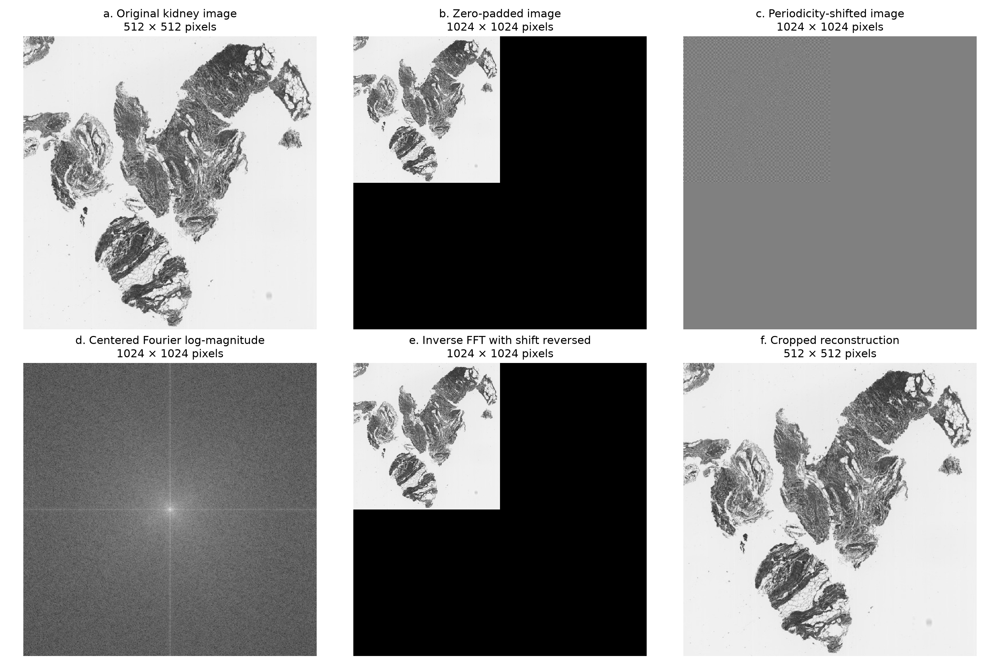

*Figure 1. Six stages of Fourier transformation and reconstruction

of the kidney image.*

The original image had dimensions of 512 × 512 pixels.

After zero padding, the working image had dimensions of

1024 × 1024 pixels.

The centred Fourier magnitude spectrum showed a strong

central region, indicating substantial low-frequency content.

After inverse Fourier transformation, reversal of the

periodicity shift and cropping, the reconstructed image was

visually indistinguishable from the original.

The numerical reconstruction results were:

| Measurement | Result |

|---|---:|

| Original dimensions | 512 × 512 |

| Padded dimensions | 1024 × 1024 |

| Maximum absolute error | \\(1.7053 \times 10^{-13}\\) |

| Mean absolute error | \\(2.4484 \times 10^{-14}\\) |

| Largest imaginary residual | \\(1.6036 \times 10^{-13}\\) |

The non-square, constant-intensity and single-pixel tests

also passed.

### Discussion
The results demonstrate that the Fourier transform and its

inverse can reconstruct the original image with negligible

numerical error when no frequency-domain modification is applied.

The maximum reconstruction error was approximately

\\(1.7 \times 10^{-13}\\), which is extremely small compared

with the intensity range of an 8-bit grayscale image.

These small differences are consistent with floating-point

rounding during numerical Fourier calculations.

Zero padding increased the dimensions of the working array

without changing the original image information.

It also provided a larger computational domain for later

frequency-domain filtering experiments.

Periodicity shifting moved the zero-frequency component to

the centre of the Fourier spectrum, making its structure

easier to interpret.

The same shifting operation was applied after inverse

transformation to recover the correct spatial representation.

The additional tests provided evidence that the functions

were not limited to the kidney image.

In particular, the non-square test demonstrated that the

implementation could process images with unequal row and

column dimensions.

The constant-intensity and single-pixel tests checked

the reconstruction process using predictable image patterns.

A limitation is that these tests establish numerical

correctness for the tested inputs, rather than proving

correctness for every possible image.

### Conclusion
The six-stage Fourier processing pipeline successfully

transformed and reconstructed the kidney image.

The reconstructed image agreed with the original to

floating-point precision.

The reusable functions developed in this experiment provide

the foundation for frequency-domain filtering and image

restoration in the following sections.

## 1.2 Fourier Analysis of Generated Images
### Objective
The objective of this experiment was to investigate the

relationship between spatial image patterns and their

Fourier frequency components.

Four synthetic grayscale images were generated using known

mathematical expressions.

Their Fourier spectra were predicted theoretically and

compared with the calculated results.

### Theoretical Background
A two-dimensional cosine image can be represented by:

\\[

f(r,c)=B+A\cos\left[

2\pi\left(

\frac{k_r r}{M}+\frac{k_c c}{N}

\right)

\right]

\\]

where:

- \\(B\\) is the background intensity.

- \\(A\\) is the cosine amplitude.

- \\(M\\) and \\(N\\) are the image dimensions.

- \\(k_r\\) is the vertical spatial frequency index.

- \\(k_c\\) is the horizontal spatial frequency index.

- \\(r\\) and \\(c\\) are the row and column coordinates.

A constant image contains only a zero-frequency component,

also called the DC component.

For a constant image with intensity \\(B\\), the DC magnitude is:

\\[

|F\_{\mathrm{DC}}|=BMN

\\]

A cosine pattern with nonzero integer frequencies aligned

with the discrete Fourier grid produces two symmetric

frequency components.

The magnitude of each cosine component is:

\\[

|F\_{\mathrm{cosine}}|=\frac{AMN}{2}

\\]

These expressions assume a nonzero, non-Nyquist frequency

and no overlap between the predicted peaks.

The two symmetric components arise from Euler's identity:

\\[

\cos(\theta)=

\frac{e^{i\theta}+e^{-i\theta}}{2}

\\]

Therefore, one cosine pattern can be represented by two

complex exponential components with opposite frequencies.

### Materials and Methods
Four synthetic grayscale images were generated using NumPy.

Each image had dimensions of 256 × 256 pixels.

The constant image had an intensity of 128.

For the cosine images, the background intensity was 128

and the amplitude was 100.

Consequently, the cosine images had intensity values

ranging from 28 to 228.

The four experiments were:

| Image | Row frequency | Column frequency |

|---|---:|---:|

| Constant image | 0 | 0 |

| Vertical stripes | 0 | 8 |

| Horizontal stripes | 8 | 0 |

| Diagonal stripes | 6 | 8 |

The implementation used a reusable cosine-image generator

to create the patterns.

The Fourier transform was calculated using

`numpy.fft.fft2()`.

The resulting spectrum was centred using

`numpy.fft.fftshift()`.

Fourier magnitudes were calculated using `numpy.abs()`.

Logarithmic scaling was applied for visualization.

Each output figure contained:

1. The synthetic grayscale image.

2. The complete centred Fourier magnitude spectrum.

3. An enlarged central region of the spectrum.

The calculated peak positions and magnitudes were compared

with theoretical predictions.

The largest unexpected Fourier coefficient was also measured

after excluding the predicted peak locations.

#### Relationship Between the Two Centering Methods
Section 1.1 used multiplication by \\((-1)^{r+c}\\)

before Fourier transformation.

Section 1.2 used `numpy.fft.fftshift()` after

Fourier transformation.

For the even-sized arrays used in these experiments,

both methods place the zero-frequency component at

the centre of the spectrum.

The first method modifies the spatial array before

transformation, whereas the second rearranges the

Fourier coefficients after transformation.

Both are appropriate for visualizing centred spectra

under the conditions used here.

### Results
#### Constant-Intensity Image
The constant image produced one nonzero Fourier coefficient

at the centre of the spectrum.

The peak was located at (128, 128).

The theoretical DC magnitude was:

\\[

128 \times 256 \times 256 = 8,388,608

\\]

The measured magnitude was also 8,388,608.

No unexpected frequency components were detected.

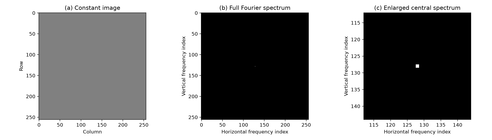

*Figure 2. Constant-intensity image, full Fourier magnitude

spectrum and enlarged central spectrum.*

#### Vertical Cosine Stripes
The vertical-stripe image used a column frequency of 8.

The predicted peak positions were:

- (128, 120)

- (128, 128)

- (128, 136)

The DC magnitude was 8,388,608.

The theoretical magnitude of each cosine peak was:

\\[

\frac{100 \times 256 \times 256}{2}

=3,276,800

\\]

The measured magnitudes agreed with these predictions.


*Figure 3. Vertical cosine stripes and their Fourier magnitude

spectrum, showing symmetric peaks along the horizontal

frequency axis.*

#### Horizontal Cosine Stripes
The horizontal-stripe image used a row frequency of 8.

The predicted peak positions were:

- (120, 128)

- (128, 128)

- (136, 128)

The DC magnitude was 8,388,608.

Each non-DC peak had a magnitude of 3,276,800.

The measured peak positions and magnitudes matched

the theoretical predictions.

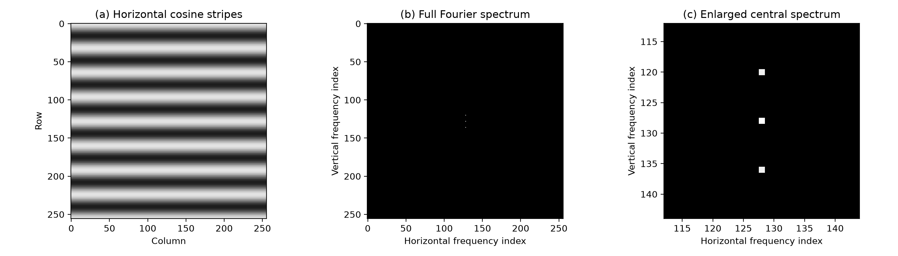

*Figure 4. Horizontal cosine stripes and their Fourier magnitude

spectrum, showing symmetric peaks along the vertical

frequency axis.*

#### Diagonal Cosine Stripes
The diagonal-stripe image used a row frequency of 6

and a column frequency of 8.

The centre of the Fourier spectrum was (128, 128).

The predicted non-DC peak positions were calculated as:

\\[

(128-6,\\;128-8)=(122,120)

\\]

and

\\[

(128+6,\\;128+8)=(134,136)

\\]

The three principal peak positions were therefore:

- (122, 120)

- (128, 128)

- (134, 136)

The DC magnitude was 8,388,608.

Each non-DC peak had a magnitude of 3,276,800.

The measured values agreed with the theoretical predictions.

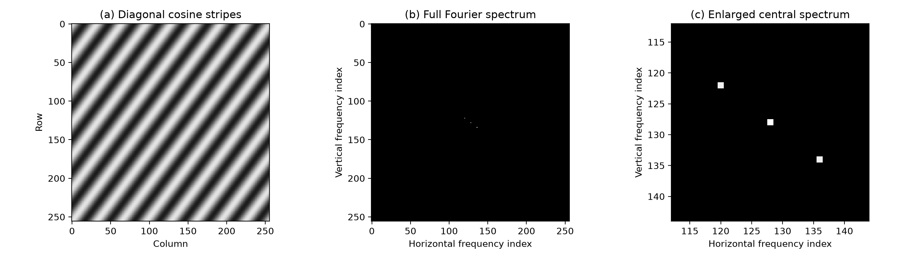

*Figure 5. Diagonal cosine stripes and their Fourier magnitude

spectrum, showing frequency components displaced along

both frequency axes.*

#### Numerical Validation
The largest unexpected Fourier coefficients were:

| Image | Largest unexpected coefficient |

|---|---:|

| Constant | 0 |

| Vertical stripes | \\(2.003150 \times 10^{-9}\\) |

| Horizontal stripes | \\(2.003150 \times 10^{-9}\\) |

| Diagonal stripes | \\(1.681796 \times 10^{-9}\\) |

All four experiments passed the numerical validation tests.

For these experiments, the implementation used an absolute

tolerance of \\(10^{-7}\\) for unexpected Fourier coefficients.

This tolerance was suitable for the tested image dimensions

and intensity values, but it should not be interpreted as

a universal threshold for all Fourier calculations.

### Discussion
The results demonstrate a direct relationship between the

orientation of spatial intensity patterns and the location

of their Fourier frequency components.

The constant image produced only the DC component because

its intensity did not change across the image.

Vertical stripes produced horizontally displaced frequency

peaks because their intensities varied across columns.

Horizontal stripes produced vertically displaced peaks

because their intensities varied across rows.

The diagonal pattern produced peaks displaced along both

frequency axes because intensity varied in both directions.

The measured peak positions were consistent with the

frequency indices used to generate the images.

The measured peak magnitudes also agreed with the

theoretical values derived from the image dimensions,

background intensity and cosine amplitude.

The two symmetric peaks associated with each cosine pattern

are explained by its representation as two complex

exponentials with opposite frequencies.

The unexpected Fourier coefficients were extremely small

compared with the principal frequency components.

These residuals are consistent with floating-point rounding

during image generation and Fourier computation.

Because the generated patterns used integer frequencies

aligned with the discrete Fourier grid, they did not

produce significant spectral leakage.

A limitation is that the experiment did not examine

non-integer frequencies, which can distribute energy

across multiple Fourier coefficients.

The results provide a useful foundation for understanding

how frequency-domain filters can selectively preserve

or suppress different spatial patterns.

### Conclusion
The Fourier spectra of all four generated images agreed

with their theoretical predictions.

The experiments demonstrated how spatial frequency and

pattern orientation determine the location of Fourier

components.

The numerical validation supported the correctness of

the implementation for the tested patterns.

These findings provide the basis for the frequency-domain

filtering experiments in Section 1.3.

## 1.3 Frequency-Domain Filtering
### Objective
The objective of this experiment is to investigate how different frequency-domain filters modify grayscale images. Ideal, Butterworth and Gaussian low-pass and high-pass filters will be implemented and compared. The experiment will also examine the relationship between frequency-domain and spatial-domain filtering, including smoothing, edge enhancement and artifacts caused by abrupt frequency cutoffs.

### Theoretical Background
Frequency-domain filtering modifies an image by multiplying its Fourier transform by a filter transfer function. A low-pass filter retains lower spatial frequencies, which are generally associated with gradual intensity changes, while a high-pass filter retains higher spatial frequencies, which are often associated with edges and fine details.

The filters will be defined using the distance of each frequency coordinate from the centre of the Fourier spectrum. This provides a common basis for comparing ideal, Butterworth and Gaussian filters.

### Experiment 1.3.1: Ideal Low-Pass and High-Pass Filtering
#### Methods
The clean `Kidney1-Crop.tif` image, measuring 512 × 512 pixels, was used to investigate ideal frequency-domain filtering.

The image was transformed into the frequency domain using the two-dimensional fast Fourier transform. The resulting spectrum was centred, and ideal low-pass and high-pass masks were constructed using a cutoff radius of 30 frequency pixels.

The ideal low-pass filter retained frequency components within the cutoff radius and removed those outside it. The ideal high-pass filter retained components outside the cutoff radius.

Each mask was multiplied by the centred Fourier spectrum. The filtered images were reconstructed using the inverse Fourier transform.

The high-pass image was displayed with an intensity offset of 128 to make positive and negative responses visible.

#### Results
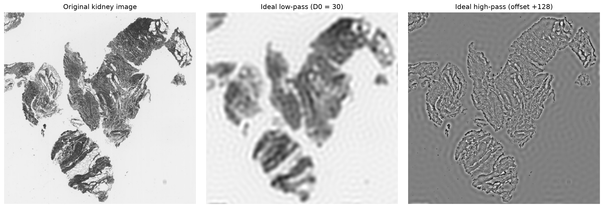

*Figure 6. Original kidney image compared with ideal low-pass and high-pass filtering at a cutoff radius of 30 frequency pixels. The high-pass result is displayed with an offset of 128.*

The low-pass filtered image appeared smoother than the original, with a noticeable reduction in fine tissue details.

The high-pass filtered image emphasized tissue boundaries and fine internal structures. Ripple-like patterns were also visible near tissue boundaries and in some background regions.

The low-pass output ranged from approximately 38.17 to 270.21, while the high-pass output ranged from approximately −153.79 to 154.00.

The maximum absolute difference between the original image and the sum of the low-pass and high-pass components was approximately \\(1.56 \times 10^{-13}\\).

#### Discussion
The results demonstrate that ideal low-pass and high-pass filters separate image information according to spatial frequency.

The low-pass filter suppressed higher-frequency components, reducing fine detail and producing a blurred appearance. The high-pass filter suppressed lower-frequency components, emphasizing rapid intensity changes associated with tissue boundaries and fine structures.

Ripple-like patterns were visible in the filtered images. These are consistent with ringing artifacts produced by the abrupt frequency cutoff of ideal filters.

The low-pass output also contained intensity values above the original 8-bit range. Such overshoot can occur during frequency-domain filtering and illustrates why filtered values should not automatically be interpreted as valid 8-bit pixel intensities.

The very small reconstruction error confirmed that the two complementary filtered components could reproduce the original image when added together, within floating-point precision.

However, this test evaluates numerical complementarity rather than the visual quality of either filtered image.

The experiment shows that ideal filters provide clear frequency separation but can introduce undesirable artifacts. This motivates comparison with Butterworth and Gaussian filters, which use smoother frequency transitions.

### Experiment 1.3.2: Butterworth Low-Pass and High-Pass Filtering
#### Methods
Butterworth low-pass and high-pass filters were applied to the clean 512 × 512 kidney image using a cutoff radius of 30 frequency pixels.

Three filter orders were investigated: 1, 2 and 4. The same input image and cutoff radius were used for every experiment to allow a direct comparison.

The Butterworth low-pass transfer function was defined as:

\\[

H\_{\mathrm{BLP}}(u,v)=

\frac{1}{1+[D(u,v)/D_0]^{2n}}

\\]

where \\(D(u,v)\\) represents frequency distance, \\(D_0\\) is the cutoff radius and \\(n\\) is the filter order.

The high-pass filter was defined as the complement of the low-pass filter:

\\[

H\_{\mathrm{BHP}}(u,v)=1-H\_{\mathrm{BLP}}(u,v)

\\]

The filtered images were reconstructed using the inverse Fourier transform. The high-pass outputs were displayed with an offset of 128 to make positive and negative responses visible.

For each filter order, numerical reconstruction accuracy was tested by adding the low-pass and high-pass components and comparing the result with the original image.

#### Results
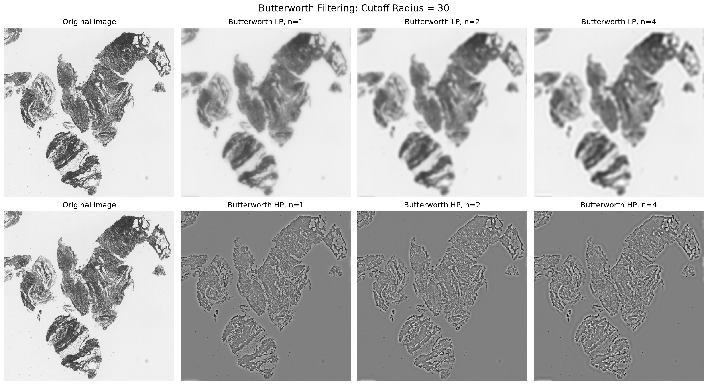

*Figure 7. Comparison of Butterworth low-pass and high-pass filtering using orders 1, 2 and 4 at a cutoff radius of 30 frequency pixels.*

All three low-pass filters reduced fine tissue details and produced smoother images than the original.

The high-pass outputs emphasized tissue boundaries and fine internal structures.

Differences were visible between the filter orders. Higher-order filters produced a sharper frequency transition, with more distinct responses around some tissue boundaries.

The maximum reconstruction errors were:

| Butterworth order | Maximum absolute error |

|---|---:|

| 1 | \\(1.705303 \times 10^{-13}\\) |

| 2 | \\(1.705303 \times 10^{-13}\\) |

| 4 | \\(1.989520 \times 10^{-13}\\) |

All numerical reconstruction tests passed.

#### Discussion
Butterworth filters provide a gradual transition between frequencies that are retained and frequencies that are suppressed.

The filter order controls the steepness of this transition. Increasing the order makes the response approach the sharp cutoff of an ideal filter.

The filtered kidney images showed differences in the preservation of tissue structures and the appearance of boundaries.

Higher-order filtering produced more pronounced boundary responses in parts of the image. Such behavior is consistent with the steeper frequency response, although the presence and magnitude of ringing require further evaluation.

The very small reconstruction errors confirmed the numerical complementarity of the low-pass and high-pass filters for all tested orders.

These findings demonstrate that filter order is an important parameter in frequency-domain image processing. A sharper cutoff is not automatically better because preserving selected frequency components may also introduce unwanted visual artifacts.

### Experiment 1.3.3: Gaussian Low-Pass and High-Pass Filtering
#### Methods
Gaussian low-pass and high-pass filters were applied to the clean 512 × 512 kidney image using a frequency-distance parameter of 30 pixels.

The Gaussian low-pass transfer function was defined as:

\\[

H\_{\mathrm{GLP}}(u,v)=

\exp\left[-\frac{D(u,v)^2}{2D_0^2}\right]

\\]

The high-pass filter was calculated as:

\\[

H\_{\mathrm{GHP}}(u,v)=1-H\_{\mathrm{GLP}}(u,v)

\\]

The image was transformed into the frequency domain, and each filter was multiplied by the centred Fourier spectrum.

The filtered images were reconstructed using the inverse Fourier transform. An offset of 128 was applied only when displaying the signed high-pass result.

Numerical accuracy was assessed by comparing the original image with the sum of the low-pass and high-pass components.

#### Results


*Figure 8. Original kidney image compared with Gaussian low-pass and high-pass filtering using a frequency-distance parameter of 30 pixels. The high-pass image is displayed with an offset of 128.*

The Gaussian low-pass filter produced a smoother image with reduced fine tissue details. The larger tissue structures remained recognizable.

The Gaussian high-pass filter emphasized tissue boundaries and fine internal structures.

The low-pass output ranged from approximately 60.80 to 241.04, while the high-pass output ranged from approximately −147.16 to 129.17.

The maximum absolute reconstruction error was \\(1.7053 \times 10^{-13}\\).

#### Discussion
The Gaussian filter attenuates frequency components gradually rather than removing them at a sharp boundary.

The low-pass result showed reduced fine detail, while the high-pass result emphasized rapid intensity changes.

Compared with the earlier ideal-filter result, the Gaussian-filtered image showed less visually apparent ringing around tissue boundaries.

This observation is consistent with the smooth Gaussian transfer function, although a controlled edge experiment is required to evaluate ringing quantitatively.

The very small reconstruction error confirmed that the complementary Gaussian low-pass and high-pass components reproduced the original image within floating-point precision.

The Gaussian parameter \\(D_0\\) does not represent the same attenuation level as the cutoff used for ideal or Butterworth filters. Consequently, comparisons using identical numerical parameters should be interpreted with this difference in mind.

Overall, the Gaussian filter provided a useful alternative to the abrupt frequency cutoff of the ideal filter.

### Experiment 1.3.4: Ringing Artifacts Around a Sharp Intensity Boundary
#### Objective
The objective of this experiment was to investigate ringing artifacts produced by different frequency-domain low-pass filters and compare their effects around a sharp intensity boundary.

#### Methods
A synthetic grayscale image measuring 256 × 256 pixels was generated. The left half had an intensity of 50, while the right half had an intensity of 200, creating a sharp vertical boundary.

Four frequency-domain low-pass filters were applied using a frequency-distance parameter of 20 pixels: ideal, Butterworth order 2, Butterworth order 4 and Gaussian.

Each filtered image was reconstructed using the inverse Fourier transform.

Intensity profiles were extracted from the middle row to examine changes around the boundary.

Ringing was quantified using two measurements:

\\[

\text{Undershoot}=\max(0,50-\min(p))

\\]

\\[

\text{Overshoot}=\max(0,\max(p)-200)

\\]

where \\(p\\) represents the filtered intensity profile.

The Fourier transform treats the image as periodic, so the discontinuity between the left and right image boundaries also contributes to the filtering response. The plotted profiles focused on the central boundary.

#### Results
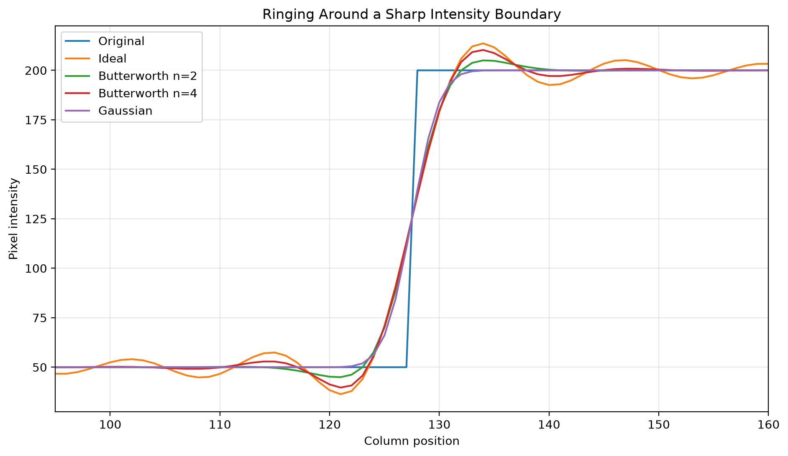

*Figure 9. Intensity profiles across a sharp boundary for ideal, Butterworth and Gaussian low-pass filters.*

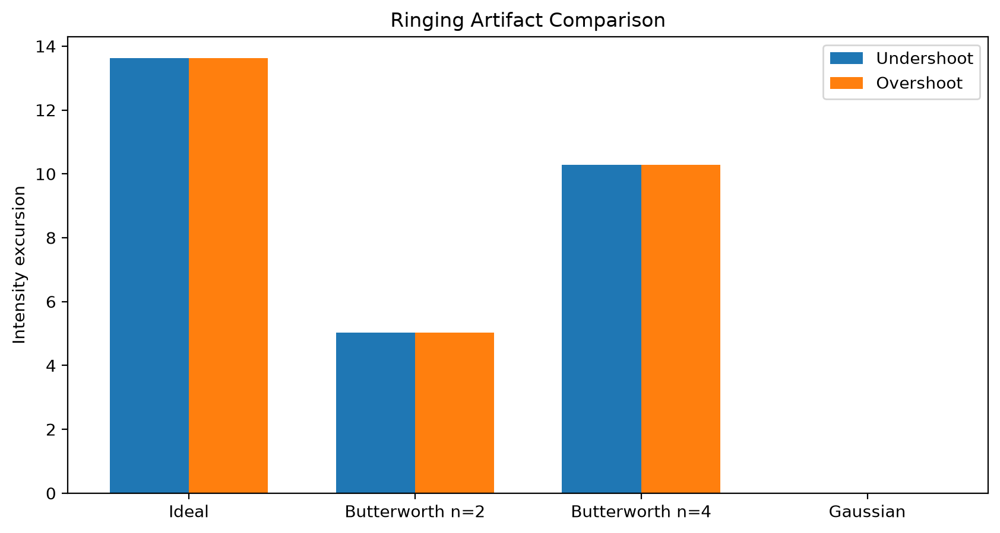

*Figure 10. Comparison of measured undershoot and overshoot for the four low-pass filters.*

The measured results were:

| Filter | Undershoot | Overshoot |

|---|---:|---:|

| Ideal | 13.616654 | 13.616654 |

| Butterworth, order 2 | 5.033053 | 5.033053 |

| Butterworth, order 4 | 10.288823 | 10.288823 |

| Gaussian | 0.000000 | 0.000000 |

The ideal low-pass filter produced the largest intensity excursions beyond the original range of 50–200.

Butterworth order 2 produced smaller excursions than Butterworth order 4.

The Gaussian filter produced no measurable overshoot or undershoot beyond the original intensity range.

#### Discussion
The results demonstrate that the shape of a frequency-domain filter influences the appearance of ringing artifacts around sharp intensity transitions.

The ideal filter has an abrupt frequency cutoff. This produces oscillations around the intensity boundary, including overshoot and undershoot. The measured overshoot was approximately 9.08% of the original intensity difference, consistent with the Gibbs phenomenon.

Butterworth filters have smoother transitions than ideal filters. However, increasing the Butterworth order makes the frequency response steeper.

In this experiment, the fourth-order Butterworth filter produced greater overshoot and undershoot than the second-order filter.

The Gaussian filter produced a smooth transition across the boundary without measurable intensity excursions outside the original range.

However, the absence of overshoot does not mean that the Gaussian filter preserves the sharp boundary. Its intensity profile still showed a gradual transition, demonstrating blurring.

The results also depend on the selected filter parameters, image dimensions and periodic boundary conditions. The numerical parameter of 20 does not represent identical attenuation for all filter families.

Overall, the experiment illustrates a trade-off between sharp frequency selection, image smoothing and ringing artifacts.

#### Conclusion
The ideal filter produced the strongest ringing artifacts, followed by Butterworth order 4 and Butterworth order 2.

The Gaussian filter produced no measurable overshoot or undershoot in this experiment, although it blurred the sharp boundary.

These results support the use of smoother frequency responses when reducing ringing artifacts is important.

### Experiment 1.3.5: Comparison of Spatial and Frequency-Domain Averaging
#### Objective
The objective of this experiment was to demonstrate the relationship between spatial-domain convolution and frequency-domain multiplication using a 3 × 3 averaging filter.

#### Methods
A 3 × 3 averaging kernel was defined as:

\\[

K=\frac{1}{9}

\begin{bmatrix}

1&1&1\\\\

1&1&1\\\\

1&1&1

\end{bmatrix}

\\]

Two implementations were compared.

In the spatial-domain implementation, each pixel was replaced by the mean intensity of its 3 × 3 neighborhood. Periodic boundary conditions were implemented using modulo indexing.

In the frequency-domain implementation, the averaging kernel was embedded into an array matching the image dimensions and aligned with the circular origin.

The Fourier transforms of the image and kernel were multiplied, and the result was reconstructed using the inverse Fourier transform.

Both implementations therefore used equivalent circular boundary conditions.

The methods were first tested on a synthetic 5 × 5 image and subsequently applied to the clean 512 × 512 kidney image.

#### Results
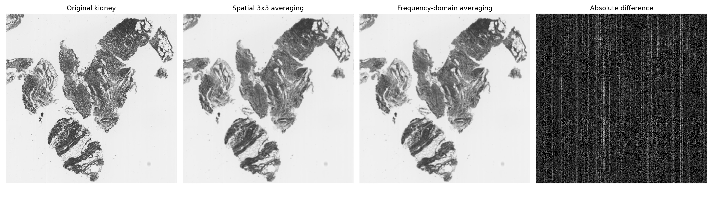

*Figure 11. Original kidney image, spatial 3 × 3 averaging, equivalent frequency-domain averaging and absolute numerical difference.*

The spatial and frequency-domain methods produced visually identical filtered kidney images.

For the 5 × 5 test image, the maximum absolute difference was:

\\[

2.1316\times10^{-14}

\\]

For the kidney image, the maximum absolute difference was:

\\[

1.7053\times10^{-13}

\\]

The mean absolute difference for the kidney image was:

\\[

2.8633\times10^{-14}

\\]

Both numerical equivalence tests passed.

#### Discussion
The results demonstrate the convolution theorem, which states that circular convolution in the spatial domain is equivalent to multiplication of the corresponding discrete Fourier transforms.

The spatial method directly averaged neighboring pixels, while the frequency-domain method performed the equivalent operation through Fourier multiplication.

The very small numerical differences are consistent with floating-point rounding.

Although the absolute-difference image contained visible patterns when automatically scaled, their numerical magnitudes were negligible.

Matching boundary conditions and correct kernel alignment were essential for achieving equivalent results.

This experiment demonstrates that spatial averaging and its corresponding frequency-domain implementation can produce the same output when their mathematical definitions are consistent.

#### Conclusion
Spatial 3 × 3 averaging and frequency-domain averaging produced equivalent results for both the synthetic test image and the kidney image.

The numerical comparisons supported the correctness of the implementations and demonstrated the relationship between spatial convolution and Fourier-domain multiplication.

### Experiment 1.3.6: Gaussian Smoothing in Spatial and Frequency Domains
#### Methods
A normalized 13 × 13 Gaussian kernel with a spatial standard deviation of 2 pixels was constructed.

The kernel was applied to the clean 512 × 512 kidney image using two methods: direct spatial convolution and frequency-domain multiplication.

Both methods used periodic boundary conditions and the same discrete kernel.

#### Results
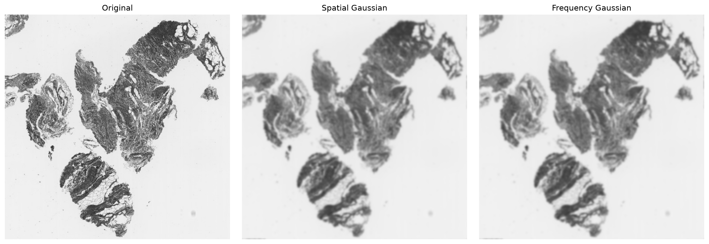

*Figure 12. Original kidney image compared with spatial and frequency-domain Gaussian smoothing.*

The Gaussian kernel coefficients summed to 1.0.

The maximum absolute difference between the two filtered images was \\(3.9790 \times 10^{-13}\\), and the mean absolute difference was \\(8.6994 \times 10^{-14}\\).

The numerical equivalence test passed.

#### Discussion
The results confirm that spatial convolution and Fourier-domain multiplication produce equivalent Gaussian-smoothed images when the same kernel and boundary conditions are used.

The small numerical differences are consistent with floating-point rounding.

This experiment demonstrates the convolution theorem using Gaussian smoothing. It does not establish exact equivalence with the separately defined analytic Gaussian frequency mask used earlier.

#### Conclusion
The spatial and frequency-domain implementations of the same discrete Gaussian filter agreed to floating-point precision.

### Experiment 1.3.7: Spatial and Frequency-Domain Differentiation
#### Methods
A horizontal forward-difference operator was applied to the clean 512 × 512 kidney image using spatial and frequency-domain implementations.

The spatial operation was defined as:

\\[

g(r,c)=f(r,(c+1)\bmod N)-f(r,c)

\\]

The equivalent frequency-domain response was:

\\[

H(v)=e^{2\pi iv/N}-1

\\]

The Fourier transform of the image was multiplied by this response, and the filtered image was reconstructed using the inverse Fourier transform.

Both methods used periodic boundary conditions.

#### Results
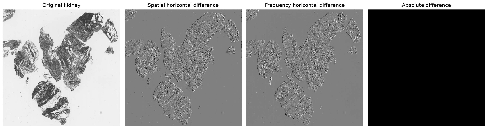

*Figure 13. Original kidney image, spatial horizontal differentiation, equivalent frequency-domain differentiation and absolute numerical difference.*

Both methods emphasized horizontal intensity changes across columns, making tissue boundaries and fine structures more visible.

The resulting derivative images appeared identical.

The maximum absolute difference between the two implementations was:

\\[

9.9476\times10^{-14}

\\]

The numerical equivalence test passed.

#### Discussion
The results demonstrate that a spatial difference operation can be represented by multiplication with an appropriate frequency-domain transfer function.

The operator suppresses constant intensity regions and responds to changes between neighboring columns.

Unlike the radial high-pass filters examined earlier, this operator is direction-dependent.

The extremely small numerical difference supports the equivalence of the two implementations under periodic boundary conditions.

#### Conclusion
Spatial horizontal differentiation and its equivalent frequency-domain implementation produced matching results to floating-point precision.

### Experiment 1.3.8: Ideal Band-Pass and Band-Stop Filtering
#### Methods
Ideal band-pass and band-stop filters were applied to the clean 512 × 512 kidney image.

The inner cutoff radius was set to 15 frequency pixels and the outer cutoff radius to 60 frequency pixels.

The band-pass filter retained frequency components within this interval, while the complementary band-stop filter suppressed them.

Both filtered images were reconstructed using the inverse Fourier transform. An intensity offset of 128 was applied only when displaying the signed band-pass output.

Numerical correctness was assessed by adding the band-pass and band-stop outputs and comparing their sum with the original image.

#### Results
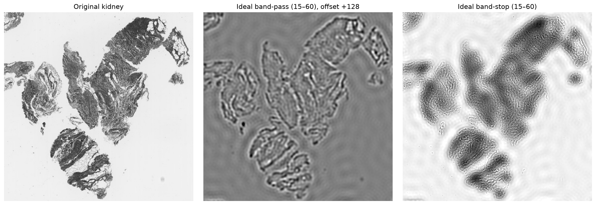

*Figure 14. Original kidney image, ideal band-pass filtering between radii 15 and 60, and complementary ideal band-stop filtering.*

The band-pass output emphasized tissue boundaries and structures associated with intermediate spatial frequencies. Its intensity values ranged from −184.40 to 126.16.

The band-stop output retained the overall tissue appearance while changing the visibility of certain structures. Its intensity values ranged from −5.39 to 307.86.

The maximum reconstruction error was:

\\[

1.6342\times10^{-13}

\\]

The numerical reconstruction test passed.

#### Discussion
Band-pass filtering isolates a selected interval of spatial frequencies. This can emphasize structures of particular spatial scales while suppressing both slowly varying background information and finer details outside the selected interval.

Band-stop filtering removes the selected frequency interval while retaining frequencies outside it.

The band-stop image showed visible halos and changes in tissue texture. These effects are consistent with the abrupt transitions of an ideal frequency filter.

Some reconstructed values fell outside the standard grayscale range of 0–255. These values were retained during processing rather than clipped, preserving the numerical results.

The very small reconstruction error confirmed that the two complementary filters reproduced the original image when their outputs were added.

#### Conclusion
The experiment demonstrated selective frequency-band filtering and verified the complementary relationship between ideal band-pass and band-stop filters.

## 1.4 Image Restoration
### Experiment 1.4.1: Restoration of Periodic Noise in Kidney Images
#### Methods
Two noisy versions of the clean 512 × 512 kidney image were investigated using ideal notch-reject filters.

The periodic interference frequencies were first identified by examining the Fourier transforms of the differences between the noisy images and the clean reference.

For Kidney Noise1, the principal interference frequencies occurred near offsets (±190, 0), (0, ±190), and combinations of ±134 in both directions.

For Kidney Noise2, the principal frequencies occurred near offsets (±45, 0), (0, ±45), and combinations of ±32 in both directions.

Symmetric circular notch-reject filters were constructed at these frequency locations. Radii of 1, 2, 3 and 5 pixels were evaluated.

Filtering was applied to the noisy images, while the clean reference was used for frequency diagnosis and quantitative evaluation. The best tested radius for each image was selected using the lowest mean squared error (MSE).

#### Results
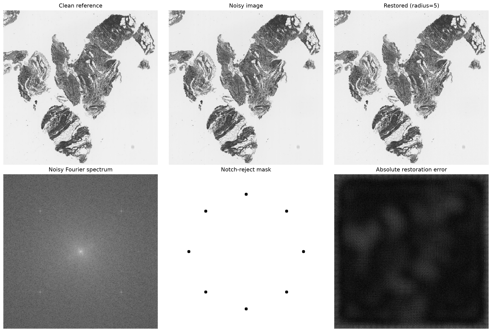

*Figure 15. Kidney Noise1 before and after ideal notch-reject filtering, including the Fourier spectrum, selected mask and absolute restoration error.*

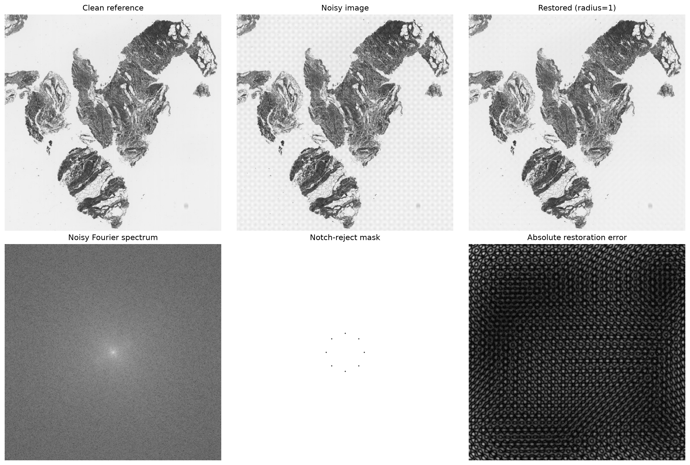

*Figure 16. Kidney Noise2 before and after ideal notch-reject filtering, including the Fourier spectrum, selected mask and absolute restoration error.*

| Image | Best radius | MSE before | MSE after | PSNR before | PSNR after |

|---|---:|---:|---:|---:|---:|

| Kidney Noise1 | 5 | 18.3355 | 1.7705 | 35.4979 dB | 45.6498 dB |

| Kidney Noise2 | 1 | 18.3085 | 1.3504 | 35.5043 dB | 46.8263 dB |

Kidney Noise1 improved by 10.1520 dB, while Kidney Noise2 improved by 11.3221 dB.

#### Discussion
Both images showed substantial reductions in periodic interference following notch filtering.

For Kidney Noise1, the best tested result was obtained with a radius of 5 pixels. The wider notches suppressed interference distributed around the dominant spectral peaks.

For Kidney Noise2, a radius of 1 pixel performed best. Increasing the radius progressively worsened the reconstruction error, suggesting that wider notches removed more genuine image information.

The experiments demonstrate the importance of selecting filter parameters according to the frequency characteristics of the noise rather than applying the same settings to every image.

The clean reference was used to identify interference frequencies and select the best tested parameters. Therefore, these results represent reference-assisted restoration experiments rather than a fully blind restoration procedure.

#### Conclusion
Ideal notch-reject filtering substantially reduced periodic interference in both kidney images. The optimal radius among the tested values depended on the distribution of the noise frequencies.

### Experiment 1.4.2: Restoration of Impulse Noise in Thorax Noise1
#### Methods
The clean `Thorax.tif` image and `Thorax-Noise1.tif`, both measuring 512 × 512 pixels, were compared to evaluate the noise and restoration performance.

Visual inspection showed numerous isolated bright and dark pixels, suggesting impulse-like noise.

Two spatial filtering methods were investigated: arithmetic averaging and median filtering. Window sizes of 3 × 3 and 5 × 5 pixels were tested for both methods.

The averaging filter replaced each pixel with the mean intensity of its neighborhood. The median filter instead used the middle value of the sorted neighborhood intensities. Reflected boundary padding was used.

Restoration performance was evaluated using mean squared error (MSE), mean absolute error (MAE), and peak signal-to-noise ratio (PSNR), calculated against the clean reference image.

#### Results
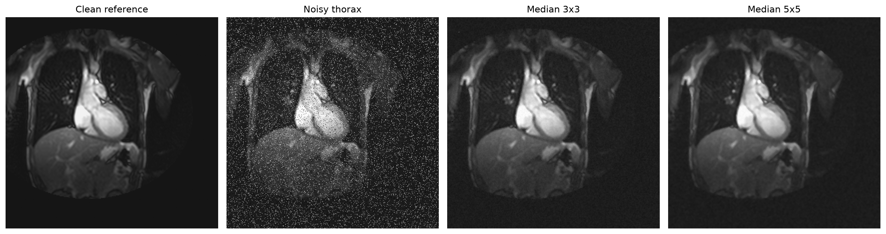

*Figure 17. Clean thorax image, noisy image, and restoration using 3 × 3 and 5 × 5 median filters.*

| Method | MSE | MAE | PSNR |

|---|---:|---:|---:|

| Noisy image | 2420.7914 | 18.7080 | 14.2912 dB |

| Averaging 3 × 3 | 478.4741 | 15.7122 | 21.3322 dB |

| Averaging 5 × 5 | 327.3604 | 15.2745 | 22.9805 dB |

| Median 3 × 3 | 64.8105 | 7.4979 | 30.0143 dB |

| Median 5 × 5 | 61.8313 | 7.4963 | 30.2187 dB |

The 5 × 5 median filter achieved the lowest MSE among the tested methods, reducing it from 2420.7914 to 61.8313.

The corresponding PSNR increased from 14.2912 dB to 30.2187 dB, an improvement of approximately 15.93 dB.

#### Discussion
Median filtering performed substantially better than averaging for this image. This result is consistent with the presence of impulse-like noise, where isolated extreme pixel values can strongly influence the arithmetic mean.

Both median filters removed much of the visible corruption. The 5 × 5 filter produced slightly better numerical results, although its larger neighborhood may also remove some fine anatomical details.

Averaging improved the noisy image but retained considerably greater error than median filtering.

#### Conclusion
For Thorax Noise1, median filtering was more effective than arithmetic averaging. The 5 × 5 median filter provided the best numerical result among the tested configurations.

### Experiment 1.4.3: Restoration of Thorax Noise2
#### Methods
The clean thorax image was compared with `Thorax-Noise2.tif`.

The noise residual was calculated by subtracting the clean reference from the noisy image. Its mean was approximately −0.0081, with a standard deviation of 6.9890 and values ranging from −32 to +30.

These measurements suggested approximately zero-mean noise distributed across the image. The results were consistent with additive noise, although they did not establish a specific probability distribution.

Arithmetic averaging and Gaussian smoothing were investigated.

Averaging windows of 3 × 3 and 5 × 5 pixels were tested. Gaussian filters were evaluated with the following configurations:

- 3 × 3, σ = 0.8

- 3 × 3, σ = 1.0

- 5 × 5, σ = 1.0

- 5 × 5, σ = 1.5

Reflected boundary padding was used. The restored images were compared with the clean reference using MSE, MAE, and PSNR.

#### Results
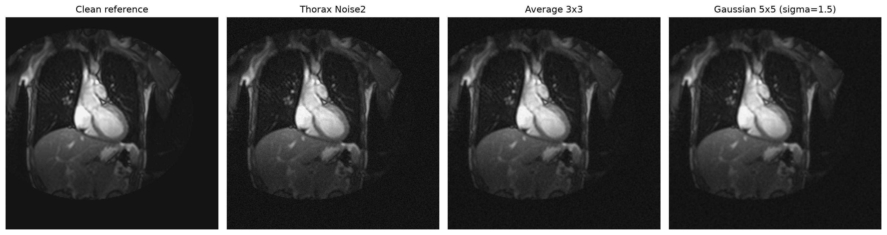

*Figure 18. Clean thorax image, Thorax Noise2, 3 × 3 averaging result, and Gaussian 5 × 5 restoration with σ = 1.5.*

| Method | MSE | MAE | PSNR |

|---|---:|---:|---:|

| Noisy image | 48.8465 | 5.5662 | 31.2425 dB |

| Averaging 3 × 3 | 6.2907 | 1.9798 | 40.1438 dB |

| Averaging 5 × 5 | 6.5697 | 1.7018 | 39.9554 dB |

| Gaussian 3 × 3, σ = 0.8 | 7.7546 | 2.2179 | 39.2352 dB |

| Gaussian 3 × 3, σ = 1.0 | 6.7255 | 2.0601 | 39.8535 dB |

| Gaussian 5 × 5, σ = 1.0 | 5.2923 | 1.7866 | 40.8943 dB |

| Gaussian 5 × 5, σ = 1.5 | 5.0478 | 1.6198 | 41.0998 dB |

The Gaussian 5 × 5 filter with σ = 1.5 produced the lowest MSE among the tested configurations.

Its PSNR was 41.0998 dB, representing an improvement of approximately 9.86 dB over the noisy image.

#### Discussion
Unlike Thorax Noise1, Thorax Noise2 responded particularly well to Gaussian smoothing and averaging.

Gaussian smoothing reduced the distributed noise by combining neighboring pixel values with weights determined by their distance from the center.

The 5 × 5 Gaussian filter with σ = 1.5 provided the best tested result, although stronger smoothing can reduce fine anatomical detail.

The comparison demonstrates that restoration methods should be selected according to the characteristics of the noise and the image rather than using one filter for every case.

#### Conclusion
Gaussian smoothing was effective for Thorax Noise2. The 5 × 5 Gaussian filter with σ = 1.5 achieved the lowest MSE and highest PSNR among the tested configurations.

### Overall Image Restoration Results
| Image | Best tested method | MSE before | MSE after | PSNR improvement |

|---|---|---:|---:|---:|

| Kidney Noise1 | Ideal notch, radius 5 | 18.3355 | 1.7705 | +10.15 dB |

| Kidney Noise2 | Ideal notch, radius 1 | 18.3085 | 1.3504 | +11.32 dB |

| Thorax Noise1 | Median 5 × 5 | 2420.7914 | 61.8313 | +15.93 dB |

| Thorax Noise2 | Gaussian 5 × 5, σ = 1.5 | 48.8465 | 5.0478 | +9.86 dB |

All four noisy images showed substantial quantitative improvement using the selected filters.

The results also demonstrated the limitations of individual methods. Notch filtering can suppress useful image frequencies, median filtering can remove small structures, and smoothing filters can blur anatomical details.

The best configurations were selected from the parameters tested using the clean reference images. Consequently, the reported results are reference-assisted evaluations and should not be interpreted as universally optimal restoration settings.

## General Conclusion
This assignment investigated Fourier transformation, frequency-domain filtering, spatial-frequency equivalence, and restoration of noisy grayscale images.

The Fourier reconstruction experiments demonstrated numerical accuracy close to floating-point precision. Synthetic patterns produced Fourier peaks at the theoretically predicted locations and magnitudes.

Ideal, Butterworth, and Gaussian filters showed different frequency responses and visual effects. The ringing experiment demonstrated that abrupt frequency cutoffs can introduce overshoot and undershoot near sharp boundaries.

Spatial averaging, Gaussian smoothing, and differentiation were also compared with equivalent frequency-domain implementations. Their small numerical differences supported the convolution theorem and the correctness of the tested implementations.

Finally, four noisy images were restored using methods selected according to their noise characteristics. Notch filtering performed well for periodic kidney interference, median filtering for impulse-like thorax noise, and Gaussian smoothing for distributed thorax noise.

Overall, the experiments demonstrated that effective image processing requires both mathematical understanding and careful evaluation of image quality. No single filter is appropriate for every image or noise type.

## Reproducibility and Project Files

All experiments were performed using Python under Ubuntu Linux through Windows Subsystem for Linux (WSL). NumPy was used for numerical computation and Fourier transforms, Matplotlib for visualisation, and libtiff for TIFF reading. The experiment scripts and the original input TIFFs should accompany the report.

From the project root, activate the environment and make the core module importable:

```bash
cd ~/Digital_Image_Analysis/CA2_Image_Analysis
conda activate dia_ca1
export PYTHONPATH="$PWD/code/core"
```

Core implementation files:

- `code/core/fourier_transform.py`
- `code/core/frequency_filters.py`

Run the experiment scripts from the project root:

```bash
python code/core/fourier_transform.py
python code/core/frequency_filters.py
python code/experiments/kidney_fourier.py
python code/experiments/synthetic_fourier.py
python code/experiments/ideal_filter_kidney.py
python code/experiments/butterworth_kidney.py
python code/experiments/gaussian_kidney.py
python code/experiments/ringing_comparison.py
python code/experiments/spatial_frequency_comparison.py
python code/experiments/gaussian_spatial_comparison.py
python code/experiments/differentiation_comparison.py
python code/experiments/band_filter_comparison.py
python code/experiments/inspect_noise.py
python code/experiments/noise_baseline.py
python code/experiments/kidney_noise_peaks.py
python code/experiments/kidney_notch_restoration.py
python code/experiments/thorax_impulse_restoration.py
```

Input images are stored in `data/raw/ImgSetCa2/`. Figures are stored in `results/figures/`. Reported image-restoration settings were selected using the clean reference images, so the comparison is reference-assisted rather than blind. The listed commands and figure paths should be checked against the final submission directory before packaging.
