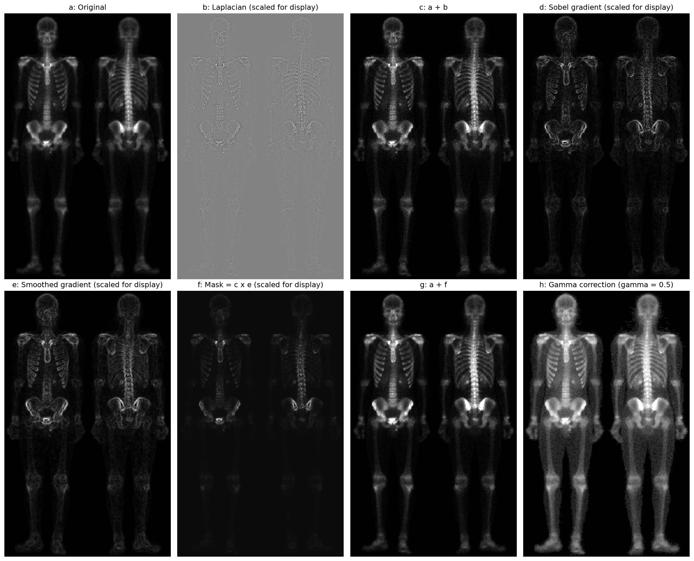
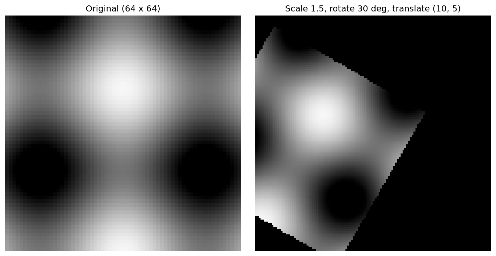
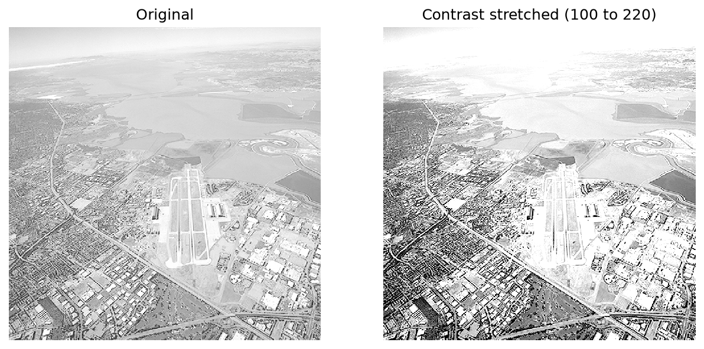
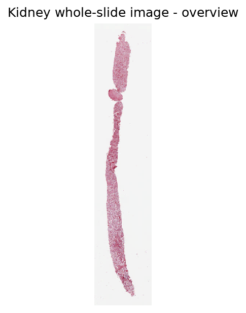

# Biomedical Digital Image Analysis Using Python

**Author:** Ahmed Yomi Isiaka  
**Institution:** Vilnius University, Faculty of Medicine  
**Programme:** MSc Systems Biology  
**Course:** Introduction to Image Analysis  
**Year:** 2026

## Project Overview

This project explores fundamental digital image processing techniques using Python, with particular emphasis on biomedical microscopy and whole-slide imaging.

The work includes image inspection, intensity transformations, spatial filtering, geometric transformations and quantitative analysis of kidney tissue segmentation masks.

The objective is to understand how digital images are represented, transformed, enhanced and analyzed, and how these methods can be applied to biomedical imaging problems.

## Key Techniques

### 1. Microscopy Image Inspection

- Reading and inspecting TIFF image files.
- Examining image dimensions, pixel types and TIFF metadata.
- Working with multiple TIFF image directories.
- Exploring fluorescence microscopy channels and RGB composites.
- Inspecting whole-slide microscopy images and image tiles.

### 2. Intensity Transformations

- Gamma correction for image brightness adjustment.
- Piecewise-linear contrast stretching.
- Histogram computation and visualization.
- Histogram equalization.
- Lookup-table-based intensity transformations.

### 3. Spatial Filtering and Image Enhancement

- Averaging filters for image smoothing.
- First-order derivative filtering.
- Laplacian filtering for edge enhancement.
- Unsharp masking.
- Multistage image enhancement combining sharpening, gradient information and gamma correction.

### 4. Geometric Image Transformations

- Image translation.
- Nearest-neighbor scaling.
- Bilinear interpolation.
- Composite affine transformations combining scaling, rotation and translation.

### 5. Kidney Tissue Segmentation Analysis

Segmentation masks were analyzed to investigate the spatial overlap between glomeruli, tubules and peritubular capillaries.

The analysis included:

- Inspection of segmentation labels.
- Mapping physical coordinates to image pixels.
- Identification of selected glomerular regions.
- Calculation of tissue overlap areas.
- Comparison between segmentation-grid and whole-slide-image-grid measurements.

For two analyzed glomerular regions, the WSI-grid measurements were:

| Measurement | Glomerulus 4 | Glomerulus 5 |
|---|---:|---:|
| Glomerular area (µm²) | 14,490.06 | 15,291.88 |
| Tubule overlap (µm²) | 315.76 | 212.45 |
| Capillary overlap (µm²) | 679.51 | 858.59 |
| Tubule overlap (%) | 2.18% | 1.39% |
| Capillary overlap (%) | 4.69% | 5.61% |

Glomerulus 3 could not be quantified because no glomerular label pixels were identified within its specified bounding box. These measurements assume correct spatial alignment between the masks and image coordinate systems.

## Technologies Used

- **Python** — image processing implementations.
- **NumPy** — numerical arrays and pixel operations.
- **Matplotlib** — image visualization and plotting.
- **libtiff** — reading and inspecting TIFF images.
- **Git and GitHub** — project version control.
- **Ubuntu / WSL and VS Code** — development environment.

## Repository Structure

```text
Biomedical-Digital-Image-Analysis/
├── code/         # Python implementations
├── results/      # Generated figures and comparisons
├── report/       # Experimental observations
├── README.md
└── .gitignore
```

## Selected Results

### Multistage Image Enhancement



### Composite Affine Transformation



### Contrast Enhancement



### Kidney Whole-Slide Image



## Reproducibility

The Python scripts are organized in the `code/` directory. The original microscopy datasets are not distributed with this repository.

Running the scripts requires access to the corresponding input images and a compatible Python environment with NumPy, Matplotlib and libtiff.

## Project Context

This repository documents coursework completed during the MSc Systems Biology programme at Vilnius University.

It demonstrates foundational computational image analysis skills relevant to biomedical research, microscopy and quantitative image processing.

## Limitations

- The original image datasets are not included.
- Some scripts use dataset-specific paths and image structures.
- Segmentation overlap measurements depend on coordinate alignment assumptions.
- The project is an educational implementation of image analysis techniques rather than a validated clinical image analysis pipeline.

## Author

**Ahmed Yomi Isiaka**  
MSc Systems Biology, Vilnius University

Research interests: bioinformatics, systems biology, computational biology, biomedical image analysis and network-based analysis of disease mechanisms.